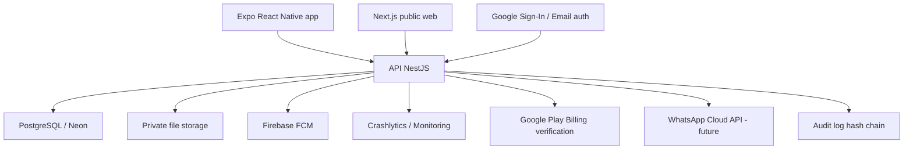

# Coparent Global - Arquitectura Tecnica Objetivo

## Resumen ejecutivo

Coparent Global ya tiene una base razonable para una prueba cerrada: app mobile con Expo/React Native, backend NestJS, Prisma, PostgreSQL/Neon, frontend web en Next.js, Firebase para notificaciones/Crashlytics, Google Play Billing preparado y despliegue en Vercel.

La arquitectura recomendada no es reemplazar todo, sino ordenar el sistema en capas mas claras, endurecer seguridad y privacidad, y preparar crecimiento internacional. El foco tecnico debe estar en:

- Aislamiento estricto por familia.
- Registro auditable de mensajes, gastos, invitaciones y cambios.
- Offline controlado en mobile.
- Notificaciones confiables.
- Almacenamiento privado de comprobantes.
- Integracion con WhatsApp siempre con confirmacion humana.
- Exportaciones claras, verificables y sin prometer validez legal universal.

## Arquitectura recomendada



## Frontend mobile

### Recomendacion

Mantener Expo React Native. Es correcto para Android, rapido para iterar y suficiente para el MVP global.

### Responsabilidades

- Login, registro, Google Sign-In y recuperacion.
- Onboarding simple: crear familia, aceptar invitacion o usar sin la otra parte.
- Calendario, mensajes, gastos, familia, perfil, privacidad y exportaciones.
- Cache local y cola offline para acciones no destructivas.
- Push notifications.
- Captura de errores con Crashlytics.
- i18n real: espanol e ingles desde una unica fuente de textos.

### Mejoras necesarias

- Separar `App.tsx` en pantallas y componentes. Hoy concentra demasiada logica.
- Crear carpetas:
  - `src/screens`
  - `src/components`
  - `src/hooks`
  - `src/features/messages`
  - `src/features/calendar`
  - `src/features/expenses`
  - `src/features/privacy`
- Agregar estado persistido tipado para sesion, familia activa, idioma y cola offline.
- Evitar textos hardcodeados fuera de `i18n.ts`.

## Frontend web

### Recomendacion

Mantener Next.js en Vercel para:

- Pagina publica.
- Politica de privacidad.
- Terminos.
- Eliminacion de cuenta.
- Links de invitacion.
- Reset/verificacion de email.
- Landing liviana para testers y futuros usuarios.

### Mejoras necesarias

- La pagina de invitacion debe explicar claramente:
  - Que es Coparent Global.
  - Que se necesita estar como tester en prueba cerrada.
  - Link de Google Play.
  - Link de invitacion familiar.
  - Que hacer si aparece "Aplicacion no disponible".
- Agregar pagina `/download` como destino unico para WhatsApp, testers y futuras campanas.

## Backend

### Recomendacion

Mantener NestJS modular. La division actual es buena:

- `auth`
- `families`
- `children`
- `calendar`
- `messages`
- `expenses`
- `whatsapp`
- `notifications`
- `subscriptions`
- `account`
- `audit`

### Principio clave

Ningun endpoint debe operar solo por `userId`. Todo lo sensible debe validar:

1. Usuario autenticado.
2. Familia existente.
3. Usuario pertenece a esa familia.
4. Rol/permisos para la accion.
5. Restricciones segun modo de coparentalidad.

### Modulos nuevos recomendados

- `exports`: generar reportes basicos y verificables.
- `files`: almacenamiento privado de comprobantes.
- `relationship-mode-policy`: reglas por modo cooperativo, estructurado y alto conflicto.
- `moderation`: revision de tono, abuso y lenguaje agresivo.
- `webhooks`: Google Play, Firebase/FCM, WhatsApp, futuros proveedores.

## Base de datos

### Recomendacion

Mantener PostgreSQL con Prisma. Es la mejor decision para este producto porque hay relaciones fuertes entre usuarios, familias, hijos, gastos, eventos, mensajes, auditoria e invitaciones.

### Fortalezas actuales

- Modelos separados por familia.
- Invitaciones con token hasheado.
- Auditoria con hashes.
- Mensajes con categoria y estado.
- Comprobantes con hash.
- Suscripciones por familia.
- Configuracion regional por familia.

### Mejoras recomendadas

- Agregar indices para consultas frecuentes:
  - mensajes por `familyId + createdAt`
  - gastos por `familyId + createdAt`
  - eventos por `familyId + startDate` o derivado desde `childId`
- Mover comprobantes grandes fuera de Postgres cuando crezca el uso.
- Agregar tabla de `ExportJob` para exportaciones asincronas.
- Agregar tabla de `FamilyPermissionPolicy` si los modos de relacion crecen.
- Registrar `ipHash`, `userAgentHash` y `requestId` en auditoria sensible sin exponer datos innecesarios.

## Archivos y comprobantes

### Estado actual

El modelo permite `ExpenseReceipt` con `content Bytes`, util para MVP y prueba cerrada.

### Arquitectura objetivo

Para produccion, usar almacenamiento privado:

- Opcion simple: Vercel Blob privado o storage compatible S3.
- Opcion robusta: Google Cloud Storage con URLs firmadas.

Reglas:

- Nunca URL publica permanente.
- Descargar con endpoint autorizado.
- Guardar `sha256`, `mimeType`, `fileSize`, `uploadedById`.
- Limite de tamano.
- Escaneo basico de tipo MIME.

## Autenticacion

### Recomendacion

Mantener email/password + Google Sign-In.

### Reglas

- JWT corto para acceso.
- Refresh token rotativo o `authVersion` para invalidar sesiones.
- Google Sign-In debe validar ID token en backend.
- El backend no debe confiar en datos enviados por el cliente excepto el token validado.
- Mantener email verificado para acciones sensibles.

### Mejoras

- Agregar rate limiting en login, reset y verificacion.
- Bloqueo temporal ante intentos repetidos.
- Registro de dispositivos.
- Revocar sesiones desde perfil.

## Autorizacion

### Politica recomendada

Crear un guard/helper central:

```text
assertFamilyAccess(userId, familyId, action)
```

Debe validar:

- Membresia familiar.
- Rol.
- Modo de coparentalidad.
- Si la accion requiere confirmacion.
- Si el recurso pertenece a esa familia.

Acciones criticas:

- Ver mensajes.
- Crear mensaje.
- Crear/editar/cancelar evento.
- Crear gasto.
- Ver comprobante.
- Exportar informacion.
- Invitar miembros.
- Cambiar modo de coparentalidad.
- Solicitar eliminacion de cuenta.

## APIs

### Estructura recomendada

Versionar API:

```text
/v1/auth
/v1/families
/v1/children
/v1/calendar
/v1/messages
/v1/expenses
/v1/invitations
/v1/exports
/v1/privacy
/v1/subscriptions
/v1/notifications
/v1/whatsapp
```

### Contratos

- DTOs con `class-validator`.
- Errores normalizados:
  - `code`
  - `message`
  - `requestId`
  - `recoverable`
- Idempotencia en acciones moviles:
  - mensajes
  - gastos
  - eventos
  - confirmaciones offline

## Offline y sincronizacion

### Recomendacion

Implementar offline parcial, no total.

Permitido offline:

- Borradores de mensajes.
- Borradores de gastos.
- Borradores de eventos.
- Lectura de ultimo estado sincronizado.

No recomendado offline sin confirmacion del servidor:

- Cancelar eventos.
- Eliminar cuenta.
- Confirmar acciones de WhatsApp.
- Cambiar modo de coparentalidad.
- Aceptar invitaciones.

### Cola local

Cada accion offline debe tener:

- `clientMutationId`
- tipo de accion
- payload
- fecha local
- estado: pending/syncing/failed/synced

El backend debe aceptar `clientMutationId` para evitar duplicados.

## Notificaciones

### Recomendacion

Firebase Cloud Messaging.

Eventos a notificar:

- Invitacion recibida.
- Evento creado o modificado.
- Solicitud de cambio.
- Gasto registrado.
- Comprobante agregado.
- Mensaje urgente.
- Accion WhatsApp pendiente de confirmar.

Reglas de privacidad:

- No incluir datos sensibles completos en el push.
- Evitar contenido agresivo o mensajes completos en notificaciones.
- Ejemplo: "Tenes una novedad familiar para revisar".

## WhatsApp

### Recomendacion

Fase 1: compartir hacia Coparent + bandeja de confirmacion.

Fase 2: WhatsApp Cloud API con bot.

Nunca debe impactar automaticamente sin confirmacion. El flujo seguro es:

1. Usuario envia texto/foto por WhatsApp.
2. Backend interpreta posible accion.
3. Crea `WhatsAppPendingAction`.
4. App muestra "Pendiente de aprobacion".
5. Usuario confirma.
6. Recien ahi se crea evento, gasto o nota.

Valor diferencial:

- Capturar gastos desde foto.
- Convertir texto en borrador de evento.
- Registrar intento de comunicacion.
- Todo con confirmacion y auditoria.

## Pagos

### Recomendacion

Para Android, Google Play Billing verificado por backend.

Modelo:

- Plan gratis: familia, hijos, calendario basico, mensajes basicos, gastos basicos.
- Plus: comprobantes, saldos, exportacion basica, mas almacenamiento.
- Premium: exportacion verificable, historial avanzado, modos alto conflicto, soporte prioritario.
- Profesional: panel para mediadores/abogados, varias familias, exportaciones profesionales.

Regla etica:

No cobrar por funciones esenciales de seguridad, privacidad, eliminacion de cuenta o acceso a datos propios.

## Infraestructura

### Actual

- Vercel para backend/frontend.
- Neon/PostgreSQL.
- Firebase.
- Google Play Console.

### Recomendacion corto plazo

Mantener Vercel + Neon. Es economico y suficiente para prueba cerrada y MVP.

### Recomendacion cuando crezca

- Backend NestJS en Cloud Run o contenedor dedicado si Vercel serverless queda corto.
- Neon o PostgreSQL gestionado con backups.
- Storage privado externo para comprobantes.
- Redis/Upstash para rate limiting y colas livianas.
- Worker separado para exportaciones y procesamiento pesado.

## Observabilidad

### Necesario antes de produccion

- Crashlytics mobile.
- Logs estructurados backend.
- `requestId` por request.
- Alertas de errores 5xx.
- Alertas de fallos de login/Google Sign-In.
- Dashboard:
  - familias activas
  - invitaciones aceptadas
  - mensajes enviados
  - mensajes revisados por tono
  - errores mobile
  - errores backend

## Seguridad y privacidad

### Prioridad critica

- Rate limiting.
- Headers de seguridad.
- Validacion estricta de DTOs.
- Autorizacion familiar centralizada.
- No exponer comprobantes publicamente.
- Hash de invitaciones y tokens.
- Eliminacion de cuenta visible.
- Politica clara de datos de menores.
- Retencion definida para auditoria.

### Riesgos principales

- Datos de menores.
- Mensajes agresivos usados como evidencia.
- Falsa expectativa de validez legal.
- Otro progenitor no quiere usar la app.
- Comprobantes con datos sensibles.
- Links compartidos por WhatsApp.

Mitigacion:

- Consentimiento claro.
- Links con vencimiento.
- Permisos por familia.
- Exportaciones con disclaimer.
- Confirmaciones fuertes en acciones sensibles.

## Testing

### Minimo requerido

- Unit tests backend por modulo.
- Tests de autorizacion familiar.
- Tests de invitaciones.
- Tests de revision de tono.
- Tests de gastos y saldos.
- Tests de Google login.
- Smoke test contra produccion.
- Pruebas manuales con dos cuentas reales.

### Antes de produccion

- Checklist con 12 testers.
- Pruebas en Android real gama baja.
- Pruebas con conexion lenta.
- Pruebas de instalacion desde Google Play.
- Prueba de eliminacion de cuenta.
- Prueba de recuperacion de password.

## Roadmap tecnico

### Ahora - prueba cerrada

1. Corregir bugs visibles de idioma y UX.
2. Subir version estable a prueba cerrada.
3. Validar Google Sign-In en build de Play.
4. Probar con al menos 12 testers.
5. Medir invitaciones, registros, errores y retencion.

### MVP publico

1. Autorizacion familiar centralizada.
2. Comprobantes en storage privado.
3. Exportacion basica.
4. Offline parcial.
5. Notificaciones push estables.
6. Politicas completas en Google Play.
7. Billing real si se monetiza.

### Version 1

1. Exportacion verificable con hashes.
2. Modo alto conflicto mas estricto.
3. Bandeja de confirmacion WhatsApp.
4. Panel web basico.
5. Reportes mensuales.
6. Multi-idioma expandido.

### Version profesional

1. Acceso profesional por invitacion.
2. Multi-familia.
3. Exportaciones profesionales.
4. Panel para mediadores/abogados.
5. Plantillas de acuerdos y reportes.

## Decision tecnica

La arquitectura actual es adecuada para seguir a prueba cerrada. No conviene reescribir. La prioridad no es cambiar de stack, sino endurecer:

1. Seguridad y autorizacion familiar.
2. Privacidad de archivos.
3. Experiencia de invitacion/testers.
4. Observabilidad.
5. Offline e idempotencia.
6. Separacion del frontend mobile en componentes mantenibles.

Puntaje tecnico actual estimado: 7/10 para prueba cerrada, 5.5/10 para lanzamiento publico global.

